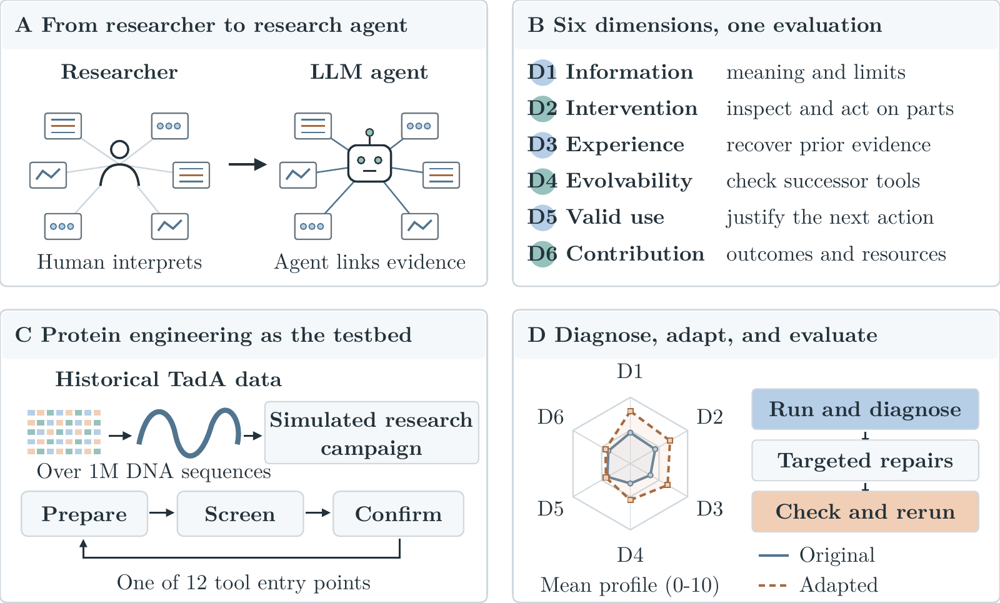

# Agent-Native Bioinformatics Tools

Research software for **Agent-Native Bioinformatics Tools: Scientific Use and Adaptation in Protein Engineering**.

This repository studies how bioinformatics tools can support a research agent throughout an investigation: interpreting a result, accessing useful molecular objects, recovering earlier evidence, checking revisions, justifying a scientific decision, and making progress under resource constraints. It contains twelve original tools, their twelve adapted counterparts, the TadA campaign simulator, and the frozen analysis tables and plotting code used by manuscript V13.3.

**Start here:** [installation](#installation), [a working tool example](#run-a-tool), [paper reproduction](#reproduce-the-paper-results), [scientific scope](docs/evaluation.md), and [data provenance](docs/provenance.md).

## Contents

- [Research scope](#research-scope)
- [Repository layout](#repository-layout)
- [Requirements](#requirements)
- [Installation](#installation)
- [Run a tool](#run-a-tool)
- [The twelve tools](#the-twelve-tools)
- [Visible inputs and decision review](#visible-inputs-and-decision-review)
- [Outputs and provenance](#outputs-and-provenance)
- [Reproduce the paper results](#reproduce-the-paper-results)
- [Rebuild the figures](#rebuild-the-figures)
- [Campaign simulator](#campaign-simulator)
- [Evaluation and interpretation](#evaluation-and-interpretation)
- [Development and validation](#development-and-validation)
- [Troubleshooting](#troubleshooting)
- [Citation](#citation)
- [License and third-party material](#license-and-third-party-material)

## Research scope

The study follows a diagnosis–adaptation–evaluation loop. Tool implementations and agent trajectories reveal missing scientific context or inaccessible intermediate objects. Adaptations address those gaps, and subsequent assessment examines both scientific use and complete campaign outcomes.

The six dimensions are:

| Dimension | Responsibility | Evidence considered |
| --- | --- | --- |
| D1: Information sufficiency | Understand a result and its assumptions | Molecular type, coordinates, strand, frame, parameters and validity conditions |
| D2: Decomposition and intervention | Access useful objects and operations | Members, windows, intermediate sequences and local transformations |
| D3: Accumulable experience | Recover applicable earlier evidence | Input, implementation, result, assumptions and subsequent consumer |
| D4: Evolvable capability | Check that a revision preserves valid behavior | Revision boundaries, scientific invariants and executed checks |
| D5: Scientifically valid use | Justify an interpretation and subsequent action | Task need → molecular input → computation → interpretation → action |
| D6: Task contribution and resource efficiency | Advance the investigation within its resources | Complete campaign outcomes, resource evidence, failures and non-use |

The biological setting is a budgeted replay of historical TadA directed evolution. An agent prepares backgrounds and libraries, screens stored candidates, confirms eligible observations, and decides when to stop. Confirmed activity is normalized to TadA8e = 1.

The manuscript reports **250 distinct campaigns**: 120 Original-tool campaigns, 120 Adapted-tool campaigns, and ten Original no-tool references. There are **120 Original/Adapted pairs**. Each repeat's no-tool reference is shared across the twelve tools. Additional attempts and Adapted no-tool controls in the underlying research archives are outside this reported population.

The tools called Original are the reconstructed deterministic offline implementations actually used in the reported Original arm. They are not a claim to reproduce the missing upstream BioSkill bundles. The Adapted packages correspond to the final evaluated tool version, historically named Agent Native v2. Paper versions, tool versions and campaign attempts have separate identities; see [provenance](docs/provenance.md).

## Repository layout

~~~text
.
├── src/
│   ├── agent_native_tools/
│   │   ├── cli.py                  # Portable launcher and synthetic examples
│   │   ├── _tools/original/        # Twelve frozen Original packages
│   │   ├── _tools/adapted/         # Twelve frozen Adapted packages
│   │   └── resources/             # Installed English campaign documents
│   └── TadACampaign/              # Simulator, Judge, runner and trajectory recorder
├── paper/
│   ├── data/                     # Frozen endpoint, state, daily and scoring tables
│   ├── figures/                  # The five manuscript figures: SVG, PDF and PNG
│   ├── scripts/                  # Endpoint recomputation and figure generation
│   └── assets/fonts/             # Latin Modern fonts and their license
├── scripts/                      # Release validation and offline run preparation
├── docs/                         # Methods, contracts, data and reproducibility
├── tests/                        # Scientific, simulator and interface checks
├── provenance/                   # Source manifest and release checksums
├── .github/workflows/ci.yml       # Offline checks; no model invocation
├── CITATION.cff
├── LICENSE
├── Makefile
├── pyproject.toml
└── uv.lock
~~~

Generated examples, new campaigns and reproduced figures go under a user-selected output directory. They are not frozen research inputs.

## Requirements

- Python **3.11 or later**.
- Linux or another POSIX environment. The Adapted packages use `fcntl` for evidence-memory locking; Linux is the tested platform.
- Biopython for the scientific packages.
- Optional campaign dependencies: PyArrow, Matplotlib and the historical policy SDK.
- Optional figure dependencies: NumPy, PyMuPDF and FontTools, plus **Inkscape** and **Poppler** command-line programs for the full manuscript figure pipeline.
- No GPU, model access, Docker or API credential is needed for tool examples, tests or recomputing the bundled paper tables.

New agent campaigns additionally require a separately configured agent client and its model access. Such campaigns consume external computation; none of the installation, test, analysis or preparation commands below launches one.

## Installation

Clone the published repository and enter its directory:

~~~bash
git clone https://github.com/Recomb27/agent-native-tool.git
cd agent-native-tool
~~~

### Recommended: locked development environment with uv

~~~bash
uv sync --locked --extra campaign --extra figures --extra dev
uv run agent-native-tool list
~~~

The committed `uv.lock` records the resolved dependency versions. Use this environment when validating a release or regenerating figures.

### Standard Python environment

~~~bash
python3 -m venv .venv
source .venv/bin/activate
python -m pip install -e .
agent-native-tool list
~~~

Install the relevant extras for simulator development, tests or plotting:

~~~bash
python -m pip install -e ".[campaign,figures,dev]"
~~~

The commands below assume an activated environment. With uv, prefix Python or CLI commands with `uv run`.

## Run a tool

Generate a small synthetic example and run the Adapted reverse-complement package:

~~~bash
agent-native-tool example reverse-complement --workspace outputs/reverse-complement
agent-native-tool run reverse-complement \
  --workspace outputs/reverse-complement \
  --rows rows.json \
  --output adapted.json
~~~

Inspect only the fields needed for interpretation:

~~~bash
python - <<'PY'
import json
from pathlib import Path
p = json.loads(Path("outputs/reverse-complement/adapted.json").read_text())
print(json.dumps({
    "tool_id": p["tool_id"],
    "payload": p["payload"],
    "scientific_brief": p["scientific_brief"],
}, indent=2))
PY
~~~

The returned object includes the reoriented sequence and its scientific scope. The example contains two synthetic 501-nucleotide sequences and a declared amino-acid window. It is an interface demonstration, with no experimental activity labels.

Compare the Original implementation using the same inputs:

~~~bash
agent-native-tool run reverse-complement \
  --arm original \
  --workspace outputs/reverse-complement \
  --rows rows.json \
  --output original.json
~~~

For the Original tool, the payload records reverse-complement identity information. The Adapted tool also returns a usable molecular object and additional interpretation and evidence records. Differences are intentional parts of the evaluated adaptations.

Read each package's instructions before applying it to other inputs:

~~~bash
agent-native-tool describe reverse-complement
agent-native-tool describe reverse-complement --arm original
agent-native-tool run --help
~~~

The example command refuses to overwrite existing input files. Choose another workspace for a fresh example.

## The twelve tools

| Tool ID | Scientific operation | Important interpretation boundary |
| --- | --- | --- |
| `codon-usage` | Count codons with declared frame and eligible range | Counts alone do not establish expression or activity |
| `distance-calculations` | Compare sequence distances and differing positions | Sequence distance is not functional improvement |
| `filter-sequences` | Filter members by explicit sequence criteria | Passing a filter does not validate a phenotype |
| `motif-search` | Locate declared motif matches | A match location is not evidence of sequence length or activity |
| `msa-statistics` | Summarize variation in supplied aligned columns | Alignment and alphabet assumptions must hold |
| `pairwise-alignment` | Align molecular objects with explicit parameters | Alignment quality does not imply a profitable experimental choice |
| `restriction-sites` | Identify supported restriction-site occurrences | Utility depends on a restriction-dependent downstream action |
| `reverse-complement` | Reorient DNA and preserve molecular identity | Reorientation does not preserve a forward coding-frame interpretation automatically |
| `sequence-properties` | Inspect length, alphabet, GC and coding QC | Sequence QC is distinct from measured biological performance |
| `sequence-slicing` | Extract declared windows with coordinate mappings | Amino-acid windows map to nucleotide intervals only under the declared frame |
| `sequence-statistics` | Summarize sequence-level counts and distributions | Summary statistics require valid units and denominators |
| `transcription-translation` | Transcribe and translate under declared coding assumptions | A valid translation does not predict experimental activity |

Package sources are under `src/agent_native_tools/_tools/<arm>/<tool_id>/`. Each Adapted package includes `SKILL.md`, `INPUT_SCHEMA.json`, `EXAMPLES.json` and `TOOL_CONTRACT.json` alongside its entry point and scientific core. These files are included in the wheel as well as the source distribution.

The portable launcher executes the preserved entry point in a separate process. This keeps each package's local scientific dependencies and dispatcher isolated. Direct historical `run.py` invocation remains available.

## Visible inputs and decision review

Adapted tools provide three modes:

| Mode | Input | Purpose |
| --- | --- | --- |
| `scientific` | Explicit molecular input object | Perform the assigned scientific computation |
| `visible` | Current public `state.json` | Build inputs from visible backgrounds and windows, then compute |
| `review` | An earlier output from the same tool | Verify its immutable scientific evidence and refresh public-state decision support |

Create a synthetic public workspace and exercise visible mode:

~~~bash
python scripts/make_visible_example.py --workspace outputs/visible
agent-native-tool run sequence-properties \
  --workspace outputs/visible \
  --mode visible --input state.json --output initial.json
agent-native-tool run sequence-properties \
  --workspace outputs/visible \
  --mode review --input initial.json --output review.json
~~~

Review reads public state, available actions, observed history and the public reward rules. It reports affordability, confirmation cost, declared noise bounds and possible reward thresholds. It does not supply a future-discovery probability. Noise-clip bounds are not calibrated confidence intervals. Affordability is not evidence of positive expected value.

A review does not pretend that an old sequence calculation covers newly visible objects. Inspect `visible_backgrounds_requiring_fresh_scientific_analysis` and recompute when necessary. Memory is workspace-bound and explicitly records missing observed actions.

## Outputs and provenance

The Original output contains a tool identifier, input hashes and a scientific payload. Adapted output adds a scientific brief, task support and references binding the result to immutable evidence.

Adapted workspaces contain:

~~~text
workspace/
├── input.json
├── result.json
├── .agent_native_evidence/<tool_id>/call-*/
│   ├── supplied_input.json
│   ├── scientific_input.json       # Scientific modes
│   ├── scientific_full.json        # Scientific modes
│   ├── core_stdout.log
│   ├── core_stderr.log
│   └── ...                        # Public snapshots and immutable result records
└── .agent_native_memory/<tool_id>.json
~~~

The output alias may be updated after another successful call. The earlier immutable records remain available. A failed Adapted call exits with code 2 and a JSON repair message; an older output alias is not evidence that the new call succeeded.

Tool-generated evidence and the campaign's recorder have different roles. A campaign recorder additionally retains per-call manifests, stdout/stderr, call ordering and a trajectory index. [The recorder documentation](docs/tool-trajectory.md) explains that structure.

## Reproduce the paper results

The fastest reproduction path uses only Python's standard library and the frozen tables included here:

~~~bash
python3 paper/scripts/recompute_results.py
~~~

The script writes `outputs/analysis/recomputed.json` and validates:

- 120 unique matched tool/repeat pairs and ten shared Original no-tool references.
- The budget identity `cash = 100000 - cost + reward`.
- Terminal cash, confirmed activity, spending, rewards and simulated days.
- Whole-repeat cluster bootstrap intervals: 20,000 draws, seed 20261104.
- All 144 integer scores, the 72 dimension changes and usage coverage.
- The 118 voluntary stops and two time-insufficient terminal states in the selected Adapted tool cohort.
- Scientific input tables and daily values where documented in the separate figure pipeline.

Expected headline results are:

| Measure | Original | Adapted |
| --- | ---: | ---: |
| Mean terminal cash | 127,999.60 | 197,147.94 |
| Mean confirmed activity | 3.8981 | 5.3934 |
| Campaigns invoking the assigned tool | 112 / 120 | 120 / 120 |
| Campaigns with trace-linked follow-up | 83 / 120 | 84 / 120 |
| Campaigns with confirmed activity above 1 | 63 / 120 | 61 / 120 |

Mean cash increases by 54.02% and mean activity by 38.36% in these historical cohorts. Ten tools improve on both means; pairwise alignment and sequence filtering decline on both. The compared campaigns occurred sequentially with execution-condition differences. These descriptive differences cannot isolate the causal effect of tool adaptation.

[The data dictionary](paper/data/README.md) describes every table. [Reproducibility instructions](docs/reproducibility.md) distinguish recomputation of bundled derived evidence from a fresh campaign experiment. Full historical session streams and raw per-call archives are not included in this compact repository. A non-resolving `archive://` identifier records provenance, not a downloadable artifact.

## Rebuild the figures

The five manuscript figures are included as SVG, PDF and PNG. Regenerate them from the frozen data:

~~~bash
python paper/scripts/make_v133_figures.py \
  --only all --output-dir outputs/figures
~~~

This requires the Python figure extra, `inkscape` and `pdftoppm` on PATH. The code uses the bundled Latin Modern font files. It writes separate outputs and numerical audit records; the frozen figures remain unchanged.

Figure 4 averages 120 Original, 120 Adapted and ten Original no-tool trajectories. Each last accepted state is carried through day 180, keeping denominators fixed. All three shaded regions show pointwise 95% intervals from 10,000 whole-repeat bootstrap draws.

For only Figure 4, a Python rendering fallback is available when Inkscape is absent:

~~~bash
python paper/scripts/make_v133_figures.py \
  --only daily --output-dir outputs/figure4
~~~

Poppler is still needed to render the PNG preview. See [figure reproduction](docs/reproducibility.md#figures) for output files and limits.

## Campaign simulator

`src/TadACampaign/` contains the historical replay environment, legal-action checks, Judge service, data preparation, agent backend adapters and trajectory recorder. Scientific rules derive from the manuscript's frozen game commit; public messages and prompts have been translated to English.

The replay starts with 100,000 simulated cash units, 180 simulated days and confirmed activity 1. Time-related burn is included in each action's total charge:

| Action | Total cash charge | Simulated days |
| --- | ---: | ---: |
| Prepare background | 2,765 | 3 |
| Prepare library | 1,742 | 2 |
| Screen 780 / 880 candidates | 8,400 / 8,460 | 9 |
| Screen 1,020 / 1,280 candidates | 9,340 / 9,400 | 10 |
| Confirm candidate | 10,067 | 12 |
| Stop | 0 | 0 |

Confirmation rewards improvements in stored activity and can fund later actions. The reward function is nonlinear and depends on the crossed activity tiers. Simulated spending is separate from model-serving cost and host runtime.

The original biological measurements are distributed by [TadA-Bench](https://github.com/shiyegao/TadA-Bench) and its [dataset repository](https://huggingface.co/datasets/JinGao/TadA-Bench/tree/07168448caaafab4efb26eca04ec3e503edf1c04). Obtain those files from the upstream source under its terms; the million-sequence dataset is not bundled here.

~~~bash
TadACampaign prepare-data --zip-path /path/to/TadABench-1M.zip --output-dir prepared
python scripts/prepare_run.py \
  --arm adapted --tool sequence-properties \
  --prepared-root prepared --output-dir outputs/run-setup
~~~

Preparation produces a local TOML configuration and tool-surface manifest. It does not contact a model. Review the generated settings before using the reference runner:

~~~bash
TadACampaign run --config outputs/run-setup/config.toml --agent
~~~

That last command launches a new agent experiment. Its output is a new observation under the local execution environment. The historical prompts were not English, client versions differed, and serving weights were not pinned; a fresh run cannot be described as a byte-identical historical replay. Read [campaign setup](docs/campaign.md) before using this path, especially for separation of private measurements from the agent workspace and cumulative runtime accounting.

## Evaluation and interpretation

D1–D5 retain the manuscript's common retrospective assessment. All 24 D6 cells were reassessed under a common outcome and Original-reference scope. Two independent AI reviewer roles score each cell; a third adjudicates. All are unblinded AI judgments, with tool and arm identities visible.

D5 covers repeats 02 and 08 for each tool and arm: **48 campaigns**, including failures and non-use. D6 uses all **240 tool campaigns** and the same ten Original no-tool references for both arms. Scores are ordinal, and their dimension means should be interpreted separately.

All twelve tools improve on D1–D4. D5 improves in four tools, is unchanged in six and declines in two. D6 improves in six and is unchanged in six. Higher invocation, a successful tool process, a saved artifact or a trace reference does not by itself establish scientifically valid use or improved task outcomes.

The public scoring CSV preserves all scores. The private-language reviewer prose is not included; the English rubric, assessment scope and tool-level interpretation boundaries are documented in [evaluation](docs/evaluation.md). Numerical reconstruction is not a fresh independent scientific adjudication.

## Development and validation

~~~bash
python scripts/verify_release.py
pytest
python paper/scripts/recompute_results.py
~~~

The release verifier scans text and filenames for CJK characters, machine-specific paths, credential-like values, missing package files and checksum inconsistencies. The test suite exercises the actual tool packages, scientific boundaries, immutable-evidence checks, legal simulator actions and recorder behavior. CI runs offline checks without invoking an agent or external model.

For the complete local environment:

~~~bash
make install
make test
make verify
make reproduce
make figures
~~~

[CONTRIBUTING.md](CONTRIBUTING.md) describes how to keep modifications separate from frozen research evidence.

## Troubleshooting

| Symptom | Resolution |
| --- | --- |
| `agent-native-tool` is not found | Activate the environment or use `uv run agent-native-tool` |
| `ModuleNotFoundError: Bio` | Install the package in the interpreter that runs the tool |
| `ModuleNotFoundError: pyarrow` | Install the `campaign` extra |
| `fcntl` is unavailable | Use Linux or a compatible POSIX environment |
| Paths must remain inside the workspace | Put scientific inputs and output paths under the selected workspace |
| Example files already exist | Choose a fresh workspace; the command preserves existing inputs |
| A call fails but an output file remains | Check the exit code and current immutable evidence; the alias may belong to an earlier call |
| Review reports an evidence hash mismatch | Restore the original scientific evidence or recompute; do not edit its hash to bypass verification |
| Inkscape or pdftoppm is missing | Install those system programs, or use the documented Figure 4 fallback |
| A raw archive identifier does not open | `archive://` is a provenance label; this release contains the documented derived tables |
| A new campaign differs from the paper | Inspect prompt language, client/runtime settings, cumulative timing and the unpinned model snapshot |

## Citation

If you use the tools or software, cite this repository and the manuscript title. Machine-readable software metadata is in [CITATION.cff](CITATION.cff).

~~~bibtex
@software{agent_native_bioinformatics_tools,
  author = {{Agent-native bioinformatics tools contributors}},
  title = {Agent-Native Bioinformatics Tools:
           Scientific Use and Adaptation in Protein Engineering},
  year = {2026},
  url = {https://github.com/Recomb27/agent-native-tool}
}
~~~

This software citation uses a collective contributor name. Manuscript author metadata and a paper DOI should be added when the authors finalize them; this repository does not assert conference acceptance or invent bibliographic details.

## License and third-party material

Repository-authored software is provided under the [MIT License](LICENSE). The bundled Latin Modern fonts retain the [GUST Font License](paper/assets/fonts/GUST-FONT-LICENSE.txt). Upstream datasets and external dependencies retain their own terms. The repository license does not relicense TadA-Bench measurements or model services.

See [THIRD_PARTY_NOTICES.md](THIRD_PARTY_NOTICES.md) for source and attribution details.

